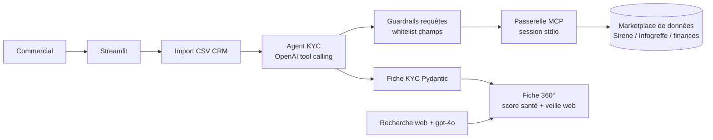

<!-- TODO: période réelle inconnue. Aucune capture d'écran disponible. -->

## Le problème

Les fiches prospects du CRM sont incomplètes : SIREN, forme juridique, dirigeants, chiffre d'affaires, effectifs manquent souvent. Les commerciaux les complètent à la main en naviguant entre registres et sites d'actualité avant chaque rendez-vous.

## La solution

Projet mené en collaboration avec un éditeur de marketplace de données partenaire, et présenté en démo live au Saegus Summit : notre agent y exploitait en direct le serveur MCP de leur marketplace.

Un agent KYC dans une interface Streamlit. Le commercial importe un export CSV du CRM ; l'agent détecte les comptes, interroge une marketplace de données open data via son serveur MCP (base Sirene, Infogreffe, états financiers, taxonomie européenne), complète les champs manquants et produit une fiche KYC prête à l'emploi. Un chat permet ensuite de poser des questions libres sur les données enrichies.

## Architecture

- Un service dédié encapsule la session MCP et liste dynamiquement les outils exposés par la marketplace.
- L'agent orchestre les appels d'outils et applique des garde-fous : le filtre proposé par le LLM est reconstruit à partir d'une whitelist de champs, les clauses de type `1=1` / `OR` injecté sont rejetées.
- Fallback structuré quand un dataset n'est pas joignable ; erreurs (timeout MCP, limite de tokens) remontées dans l'UI sans casser l'application.
- Données CRM fictives pour la démonstration.

## Fonctionnalités clés

- Aperçu des comptes détectés, enrichissement d'une entreprise ou de toutes, comptage des cellules complétées.
- Panneau dépliable qui montre en direct les outils MCP appelés, les requêtes et leurs résultats.
- Fiche 360° : récap des deals (statuts, montants, années, départements) en graphiques Plotly.
- Score de santé financière 0-100 (base 50, ajustements sur CA, résultat net, marge, EBITDA, endettement, effectifs) avec pastille verte / orange / rouge — méthode documentée.
- Veille stratégique web : recherches multi-requêtes avec backoff, synthèse structurée par catégorie et sources citées.
- Chat libre sur le CRM enrichi, exports texte et CSV.

## Mon rôle

J'ai porté ce projet seul, de bout en bout : cadrage du besoin, conception de l'architecture, développement, tests, déploiement et démonstration.

## Résultats

<!-- TODO: aucun résultat mesuré. Usage / démo à préciser. -->

- Démo live au Saegus Summit, en partenariat avec l'éditeur de la marketplace.
- PoC fonctionnel en local sur données CRM fictives et registres publics réels.
- Garde-fous anti-injection couverts par des tests dédiés.
