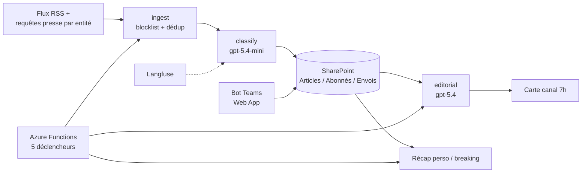

<!-- TODO: aucune capture d'écran disponible. Une capture du digest et de l'onboarding serait idéale. -->

## Le problème

Les consultants du cabinet n'ont pas de socle d'information commun. Chacun fait sa veille, ou pas, avec des sources différentes. Résultat : on arrive chez un client sans savoir qu'il vient d'annoncer un rachat, qu'un nouveau DG est arrivé ou qu'un modèle d'IA majeur est sorti la veille. Le niveau d'information varie d'une business unit à l'autre.

## La solution

Un agent Teams qui garantit un plancher d'information commun :
- **Dans un canal d'équipe** : un digest chaque matin à 7h, une carte, 7 rubriques — machine à café (sans football), M&A, prises de poste CAC 40, actualité des clients du cabinet, nouveau modèle IA, actu IA majeure, startup remarquable.
- **En message privé** : onboarding conversationnel (business unit, thèmes pré-cochés selon la BU, fréquence), récap le lundi 7h filtré sur les préférences, alertes « à chaud » le jour même.

Un article `classique` part en réserve pour le récap ; un article `breaking` part le jour même. La configuration éditoriale (flux, rubriques, consignes, entités suivies) vit dans des fichiers YAML, sans toucher au code.

## Architecture

- **Pattern Agent Orchestrateur** + traitements planifiés par timers Azure Functions (fuseau Europe/Paris forcé).
- Store = 3 listes SharePoint via Graph (permission `Sites.Selected`, moindre privilège) : l'état est inspectable et éditable sans code.
- Bot Teams sur Azure App Service, capture des `ConversationReference` pour les messages proactifs.
- Console d'admin Streamlit locale (jamais exposée) avec jeu de démo hors ligne : plan B de démo et boucle d'itération éditoriale rapide.
- Reprise des ressources Azure existantes d'une itération précédente par `terraform import`, changement de plan d'hébergement, secrets dans Key Vault.
- Réutilisation de briques éprouvées d'un précédent agent Teams interne (bot, connecteur SharePoint, messages proactifs, Langfuse).

## Fonctionnalités clés

- Ingestion RSS + requêtes presse RSS générées par entité suivie (clients du cabinet + CAC 40), blocklist déterministe football, dédup par URL canonique / titre.
- Classement LLM : rubrique, nature (`classique` / `breaking`), résumé 2 lignes, score.
- Sélection éditoriale d'un item par rubrique pour le digest.
- Garde-fous de diffusion : mode simulation par défaut (rien n'est envoyé), liste blanche de destinataires en rodage, plafond d'alertes par personne.
- Contrôle de la limite de 28 Ko des cartes Teams (échec explicite au lieu d'un rejet silencieux).
- Rapports de run honnêtes : les abonnés non joignables sont listés, jamais ignorés.
- Feedback 👍/👎 sur les cartes, poussé en score Langfuse.

## Mon rôle

Conception et développement de bout en bout : cadrage, décisions d'architecture, code, IaC, pipeline CI et tests.

<!-- TODO: confirmer / préciser le rôle. -->

## Résultats

- 197 tests unitaires, 93 % de couverture (seuil bloquant 80 %), tests LLM-as-a-Judge sur la qualité éditoriale et la fidélité.
- Quality gates CI : lint, tests, LLM-as-a-Judge, contrat des cartes, scan de vulnérabilités, détection de secrets, Terraform plan/apply manuel, déploiement OIDC, smoke test.
- Coût d'infrastructure marginal estimé à ~0 € ; seul coût variable : la consommation LLM.

<!-- TODO: pas encore en usage réel (consentement admin Graph et publication de l'app Teams en attente). Aucune donnée d'adoption. -->
