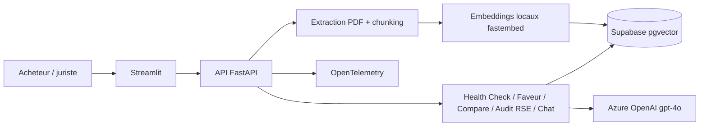

## Le problème

Les acheteurs stratégiques et les juristes d'un groupe de luxe international relisent des contrats variés (approvisionnement en matières premières, contrats d'image avec des ambassadeurs, baux commerciaux). Repérer vite les clauses à risque, savoir qui sort gagnant d'une clause et mesurer l'évolution entre deux versions demande du temps d'expert.

## La solution

Un démonstrateur d'analyse contractuelle pensé pour la direction : on dépose un PDF et l'outil produit un score de santé tricolore, une matrice des clauses stratégiques, un audit RSE au regard du référentiel interne du client et un assistant pour poser des questions sur le contrat. Un second parcours compare deux versions du même contrat.

## Architecture

## Fonctionnalités clés

- Health Check : score Vert / Orange / Rouge par pilier et synthèse exécutive en deux phrases.
- Matrice de faveur : extrait, niveau de risque, explication, suggestion de négociation et référence d'article.
- Comparaison de versions : gagnant global, scores, tableau des différences par clause.
- Audit RSE : sept critères (traçabilité, carbone, conditions de travail, biodiversité, clause de moralité, image de marque, droit d'audit) et score global.
- Assistant conversationnel sur un contrat ou sur une comparaison.
- Embeddings calculés en local (aucun appel externe pour la vectorisation).
- Tests unitaires (seuil 80 %) et LLM-as-a-Judge sur cas de test.

## Mon rôle

J'ai porté ce projet seul, de bout en bout : cadrage du besoin, conception de l'architecture, développement, tests, déploiement et démonstration.

## Résultats

<!-- TODO: aucun résultat mesuré dans le repo ; « < 30 s par contrat » est un objectif du cadrage. Données synthétiques uniquement. -->
