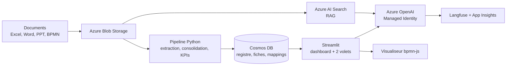

## Le problème

Le Data Management Office du client doit identifier et fiabiliser ses données critiques. Ces données sont éparpillées dans des fichiers Excel, Word et PowerPoint, mal documentées et sans responsable clair. Un Data Catalog ou un outil de Data Quality d'entreprise prendrait des mois.

En parallèle, l'équipe contribue au Système de Management des Processus (SMP) : elle doit savoir quelle donnée est manipulée à chaque étape d'un processus, et avec quelle qualité.

Les données adhérents d'une mutuelle sont des données de santé : l'architecture doit être prête pour des données sensibles, même si le POC tourne sur des données factices.

## La solution

Une application avec un agent IA et un tableau de bord d'entrée qui mène à deux volets :

- **Volet 1 — Maîtrise des données** : l'utilisateur dépose des documents par thématique (Adhérent, Produit). L'IA extrait les métadonnées, consolide, détecte similarités et incohérences, calcule des KPIs qualité (complétude, documentation, fraîcheur) et propose des arbitrages au métier.
- **Volet 2 — Contribution au SMP** : l'utilisateur dépose un BPMN et un recensement « étape → données ». L'application affiche sous chaque étape le produit de données associé. Un clic ouvre sa carte d'identité (KPIs, ownership). L'étape passe en alerte si la qualité est insuffisante.

Un assistant conversationnel reste disponible sur tous les écrans.

## Architecture

Pattern « Agent orchestrateur » enrichi d'une capacité RAG documentaire.

Infrastructure Azure en Terraform, région France Central, CI GitLab avec authentification OIDC.

## Fonctionnalités clés

- Registre des données, fiches consolidées, regroupements proposés, liste d'arbitrages.
- Détection de similarités entre libellés (ex. « N° adhérent » / « Identifiant assuré ») et d'incohérences entre fichiers.
- KPIs qualité explicables, avec accès aux indicateurs bruts.
- Score de maîtrise des données critiques.
- Visualiseur BPMN embarqué avec overlay des cartes d'identité et warnings qualité.
- Réanalyse à l'import d'un nouveau fichier, avec comparaison avant/après.
- Mode déterministe sans clé ni endpoint : l'application fonctionne sans LLM.
- Quality gates : lint et sécurité (ruff/bandit), tests > 80 %, LLM-as-a-Judge, Trivy, `terraform validate`.

## Mon rôle

Seul contributeur au code, en tant que vibecodeur du projet : architecture, jeux de données factices cohérents, pipeline, interface, IaC et CI. Projet suivi avec un PMO.

## Résultats

- Démonstration de bout en bout des deux volets sur données factices.
- Satisfaction client estimée à 8/10 dans le RETEX.
- Composant réutilisable mis en avant : la visualisation BPMN avec overlay qualité.
- Difficulté principale : produire de fausses données cohérentes entre fichiers pour faire vivre KPIs, graphe et mapping.
- Suite donnée : non connue. <!-- TODO: suite commerciale éventuelle -->
