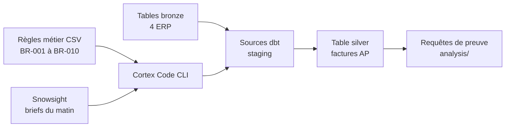

<!-- TODO: confirmer le secteur exact du client et le format de la formation (durée, nombre de participants). -->

## Le problème

Les équipes data du client veulent apprendre à coder avec un agent IA sur leur plateforme Snowflake. Une formation de ce type échoue souvent sur la préparation : postes non configurés, connexions qui ne marchent pas, données d'exercice absentes.

## La solution

Un repo de départ dbt, prêt à cloner, pour la journée de formation « Vibe coding data ». Il contient le squelette du projet, les sources déclarées, les règles métier de référence et un modèle de connexion. Les participants testent leur poste avant le jour J en 15 minutes.

Le cas d'exercice : consolider les factures fournisseurs de quatre ERP (SAP, Oracle, Baan, Workday) en une table silver normalisée, en appliquant des règles métier documentées. Les données sont fictives et viennent du guide public Snowflake « Cortex Code Foundations ».

## Architecture

## Fonctionnalités clés

- Projet dbt minimal (`staging` en vues), sources bronze en lecture seule et schéma d'écriture par participant (`DBT_SCHEMA`).
- Référentiel métier en CSV : règles de normalisation, mapping des colonnes Baan et Workday, demandes d'intégration de sources.
- Modèle de connexion pour Cortex Code, authentification par navigateur, aucun secret dans le repo.
- Checklist de préparation du poste avec vérification `/status` dans la session agent.

## Mon rôle

J'ai porté ce projet seul, de bout en bout : cadrage du besoin, conception de l'architecture, développement, tests, déploiement et démonstration.

## Résultats

<!-- TODO: date de la formation, nombre de participants, retours. -->
