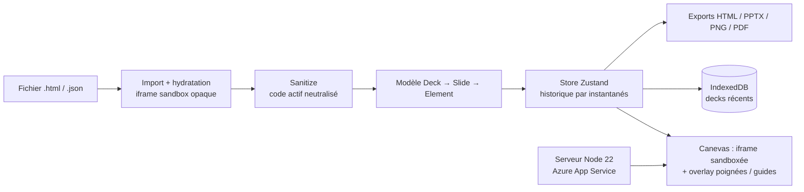

<!-- TODO: aucune capture d'écran disponible. Prévoir 2-3 captures ou un GIF du ruban + diaporama. -->

## Le problème

Les decks produits par un assistant IA sont souvent du HTML autonome : propres, mais pénibles à retoucher. Corriger un titre, déplacer un bloc ou ajouter une slide oblige à modifier le code ou à re-prompter. Convertir en .pptx casse la mise en forme. Il manquait un éditeur visuel qui travaille directement sur le HTML.

## La solution

Un éditeur « à la PowerPoint » qui ouvre un `.html` (ou l'export JSON de l'outil interne de génération de slides), permet d'éditer chaque objet directement sur la slide, de présenter, puis de ré-exporter un HTML fidèle qui s'ouvre partout.

Réécriture complète en React + TypeScript d'un premier prototype réalisé par un collègue, pour obtenir une base industrialisable (tests, IaC, CI/CD) ; elle reprend son hébergement existant (`terraform import`).

## Architecture

- Source de vérité = le HTML de chaque slide ; seuls position, taille, rotation, ordre z et texte sont abstraits.
- Rendu dans une iframe sandboxée (sans scripts) ; sélection, poignées et guides dessinés par-dessus.
- Decks générés en JS exécutés une fois dans une iframe d'origine opaque, DOM récupéré par `postMessage`, puis scripts retirés.
- Performance : déplacement via `translate` CSS + `requestAnimationFrame`, écriture du HTML au relâchement ; historique à partage structurel.
- Serveur Node sans dépendance (Brotli/gzip, cache immuable, endpoint de santé) ; IaC Terraform, workflows CI/CD manuels (plan/apply, déploiement + smoke test).

## Fonctionnalités clés

- Import `.html` (y compris decks générés en JavaScript) et `.json`, avec rapport d'import (code actif neutralisé, éléments ignorés).
- Ruban type PowerPoint avec onglet contextuel, KeyTips compatibles AZERTY, catalogue de raccourcis consultable (F1).
- Objets : sélection multiple, groupes, aimantation, rotation, alignement/répartition, pinceau, F4 pour répéter.
- Tableaux, images (collage, rognage, remplacement), styles de forme, arrière-plans.
- Transitions et animations d'entrée en CSS pur, rejouées au diaporama et dans le HTML exporté.
- Diaporama avec annotations au stylet, mode présentateur (notes, chrono, seconde fenêtre synchronisée).
- Ctrl+S dans le fichier ouvert (File System Access API), sauvegarde automatique locale avec historique d'annulation persistant.
- PWA installable, hors ligne dès la première visite.
- Exports : HTML autonome, `.pptx` (textes éditables sur l'image de la slide, notes incluses), PNG / `.zip`, impression PDF.

## Mon rôle

J'ai conçu et développé seul cette version : architecture de l'éditeur, modèle de données, import sécurisé, exports, PWA, tests (unitaires et e2e), infrastructure Terraform et pipelines de déploiement.

## Résultats

- Application déployée en interne sur Azure App Service, avec un deck de démonstration intégré.
- Objectifs de performance atteints et mesurés par un benchmark Playwright dédié : 50 slides ouvertes en 0,4 s, glisser à 16,7 ms/image.
- Qualité : lint, typecheck, tests unitaires Vitest (seuil 80 %), tests e2e Playwright, `terraform validate`.
- Un audit UI/UX a été mené puis corrigé (4 bloquants, points majeurs et secondaires, contrastes AA, thème sombre).

<!-- TODO: usage réel inconnu. Fonctions IA (réécriture, génération de slide) prévues mais non livrées. -->
