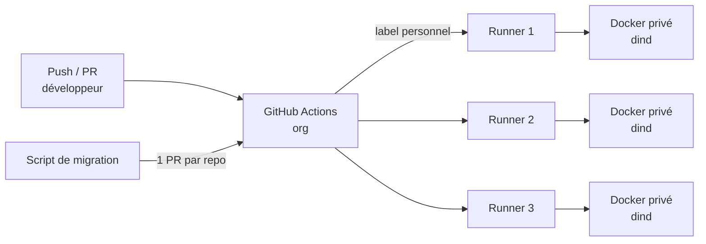

## Le problème

Les minutes GitHub Actions de l'organisation sont épuisées. Toute la CI (tests, scans, déploiements) des repos de l'équipe est bloquée. Il faut une solution immédiate, sans infrastructure supplémentaire, et qui ne mélange pas les jobs des différents développeurs.

## La solution

Un kit qui transforme le poste de chaque développeur en pool de runners self-hosted. Une seule commande (PowerShell sous Windows, Bash sous macOS / Linux) installe les prérequis, connecte le compte GitHub, construit une image de runner outillée (Trivy, Terraform) et démarre 3 conteneurs portant le label personnel du développeur.

Les workflows ciblent `runs-on: [self-hosted, linux, "<préfixe>-${{ github.triggering_actor }}"]` : la CI part sur les runners de la personne qui l'a déclenchée. Les jobs sans humain (schedule, bots, workflow_run) restent sur `ubuntu-latest`.

## Architecture

## Fonctionnalités clés

- Scripts idempotents : relancer conserve les runners existants ; une version de kit incrémentée recrée les conteneurs sans perdre l'enregistrement GitHub.
- Options `--count`, `--reinstall`, `--uninstall` sur les deux OS.
- Vérification des droits (owner ou rôle « CI/CD admin ») avec message explicite.
- Isolation : deux jobs peuvent publier le même port, les jobs n'ont pas accès au Docker du poste.
- Script de migration : simulation par défaut, mode `--apply` (branche, commit, push, PR), mode `--pr-only` ; laisse tels quels et signale matrices, runners Windows/macOS et expressions existantes ; garde `ubuntu-latest` pour les déclencheurs sans humain et les repos avec Dependabot.
- Règle intégrée à la gouvernance du kit Claude Code de l'équipe.

## Mon rôle

Conception et développement du kit, de bout en bout.

## Résultats

- CI de l'organisation débloquée sans achat de minutes ni serveur dédié.
- Premiers repos basculés sur les runners personnels de leur déclencheur.

<!-- TODO: nombre de repos migrés et de développeurs équipés ; économie de minutes estimée. -->
