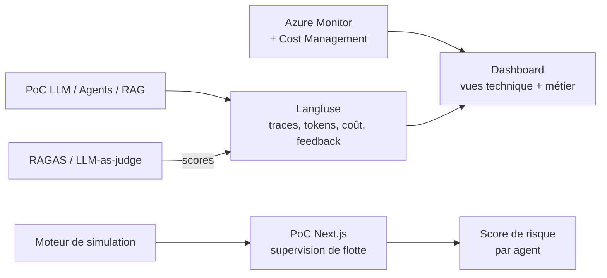

## Le problème

Le cabinet multiplie les PoC à base de LLM, d'agents et de RAG. Pour les piloter, il faut voir au même endroit la performance, la qualité, le coût et le risque de chaque assistant — et pouvoir parler aux métiers en usages et en heures gagnées, pas seulement en tokens.

Avant de construire, une question se pose : parmi les métriques qu'on aimerait afficher, lesquelles sont vraiment récupérables, et lesquelles demandent un travail d'évaluation supplémentaire ?

## La solution

Le projet s'est fait en deux temps.

**1. Maquettes et analyse des sources.** Trois itérations d'un dashboard HTML (vue globale, Agent LLM, Multi-agents, RAG, Infrastructure Azure, observabilité avancée, vue Métier par département, vue consommation). Chaque métrique est ensuite qualifiée par une pastille de faisabilité : 🟢 natif, 🟡 instrumenté, 🟠 calculé, 🔴 non disponible — côté Langfuse et côté Azure. L'analyse débouche sur une architecture de collecte et une convention de tags (`department`, `agent_name`, `architecture`, `prompt_version`, `user_id`, `session_id`).

**2. PoC Next.js de supervision de flotte.** Une application qui simule (données fictives) en temps réel une flotte d'agents répartis par département, reliés par 19 processus métier sur 8 départements, avec points de validation humaine (HITL). Elle propose six vues : Flotte, Process, Coûts, Coût / Risque, Traces, Supervision HITL.

## Architecture

## Fonctionnalités clés

- Analyse de traçabilité : pour chaque KPI (latences P50/P90/P99, taux d'erreur, hallucination, goal completion, loop rate, context recall, MRR, freshness, TPM, coûts…), la source réelle et la méthode d'obtention.
- Distinction claire entre ce qui est « gratuit » dès l'instrumentation de base et ce qui exige une étape d'évaluation (qualité sémantique, dérive, métriques multi-agents).
- Vue Métier par département : assistants actifs, usages mensuels, satisfaction, coût, tendance, KPIs spécifiques.
- PoC : grille de flotte interactive, panneau de détail par agent, historique HITL, graphe des interactions entre agents, thème clair/sombre, contrôle de la vitesse de simulation.
- Score de risque composite et stable dans le temps (criticité du domaine, outillage, autonomie, taux d'erreur), placé dans une matrice coût / risque.

## Mon rôle

J'ai porté ce projet seul, de bout en bout : cadrage du besoin, conception de l'architecture, développement, tests, déploiement et démonstration.

## Résultats

- L'analyse a montré qu'environ 80 % des métriques IA du dashboard vivent nativement dans Langfuse. Elle a directement motivé la décision de faire de Langfuse la source de vérité de l'observabilité de la plateforme interne de PoC, puis le dashboard intégré à cette plateforme.
- Recommandation de tagging et d'architecture de collecte réutilisée par les kits d'instrumentation des PoC.

<!-- TODO: le PoC Next.js de flotte a-t-il été présenté / réutilisé (démo client, intégration dans le portail) ? -->
