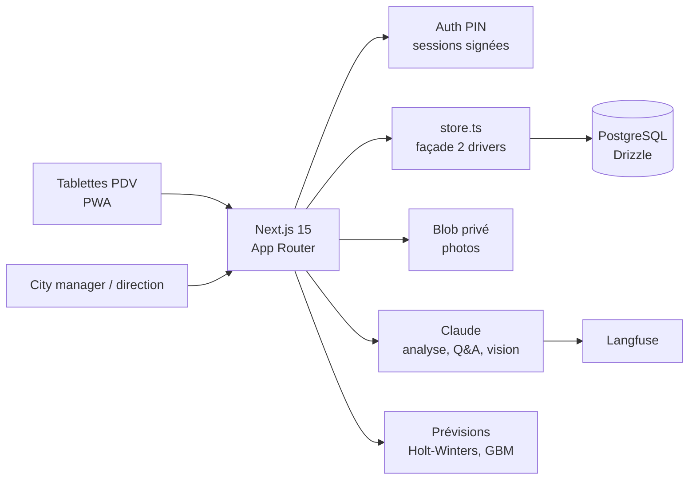

## Le problème

Le client, une enseigne de restauration, pilote ses 4 points de vente par téléphone et par mail. Les mises au rebut ne sont pas consolidées : les pertes restent invisibles. Les tournées du city manager ne laissent pas de trace exploitable. Contrôler les vitrines demande de se déplacer. Les commandes food quotidiennes génèrent erreurs et allers-retours.

Le client veut un outil unique, utilisable sur tablette en point de vente, qui fiabilise ces quatre flux et fait ressortir les tendances de pertes.

## La solution

Une plateforme web installable sur tablette, avec un accès par rôle (point de vente, city manager, direction, super admin) :

1. **Mise au rebut** : déclaration rapide des pertes, consolidation réseau, analyse IA des tendances par produit, volume et cause.
2. **City manager** : tournées avec checklist, points à traiter, historique par point de vente.
3. **Photo vitrine** : publication quotidienne depuis la caméra de la tablette, revue de conformité à distance.
4. **Commandes food** : commande de fin de journée centralisée, sans téléphone ni mail.

La direction dispose d'un tableau de bord consolidé avec prévisions et plan d'action.

## Architecture

Déploiement sur Azure App Service via Terraform et GitLab CI en OIDC (zéro secret statique), secrets dans Key Vault.

## Fonctionnalités clés

- Déclaration de rebut tactile, annulation réservée aux profils réseau pour garder la traçabilité.
- Approfondissement du rebut sur 5 axes : boucle rebut → commande, recommandations suivies en actions, saisie terrain enrichie, analyse IA plus fine, angle RSE anti-gaspillage.
- Analyse IA : tendances, questions-réponses, reconnaissance photo des invendus.
- Tableau de bord direction : vues 30 j / 7 j, axes adaptatifs, prévision Holt-Winters, comparaison avec un gradient boosting « ce que permettraient de vraies données ».
- Objectifs ajustables par point de vente, vue super admin du réseau, export CSV.
- Observabilité Langfuse : une trace par tâche métier, utilisateur haché, feedback 👍/👎 et scores du juge LLM.
- Sécurité du pilote : PIN individuel à changer à la première connexion, verrouillage progressif, rate limiting, refus de démarrer sans secret de session.
- Quality gates : ESLint, tests Vitest avec seuil > 80 %, LLM-as-a-Judge, Trivy, `terraform validate`, smoke test `/api/health`.

## Mon rôle

Seul contributeur du repo : cadrage technique, conception (ADR, design du durcissement et de la vision vitrine), développement, IaC et CI.

## Résultats

- Démonstrateur livré sur données synthétiques (4 points de vente fictifs, 30 jours d'historique), puis durci pour un pilote avec l'effectif réel.
- Vision vitrine en deux passes (« le modèle observe, le code décide ») conçue et validée en ADR ; implémentation non démarrée.
- <!-- TODO: confirmer le démarrage effectif du pilote, sa durée, le nombre d'utilisateurs et les premiers retours. -->
