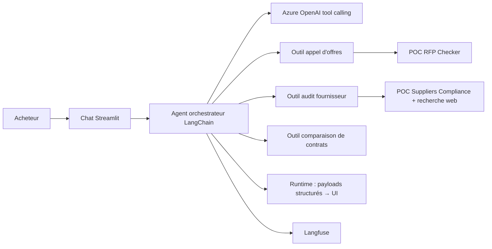

## Le problème

Le service achats d'un groupe de luxe international disposait de plusieurs POC IA spécialisés, chacun avec sa propre interface. Pour un acheteur, il fallait savoir quel outil ouvrir et comment l'alimenter. L'enjeu : offrir un point d'entrée conversationnel unique au-dessus de briques hétérogènes, sans réécrire leur logique métier.

## La solution

Un agent « chapeau » : l'utilisateur dialogue en langage naturel et l'agent choisit l'outil pertinent. « Est-ce que X a bien répondu à l'appel d'offres ? » déclenche la vérification de conformité, « fais un audit compliance de X » lance la due-diligence fournisseur, deux versions d'un contrat jointes au chat déclenchent la comparaison de clauses. Les résultats s'affichent dans la conversation avec les mêmes composants riches que les POC d'origine.

## Architecture

## Fonctionnalités clés

- Routage automatique entre trois familles de questions (appel d'offres, audit fournisseur, contrat).
- Intégration multi-POC dans un seul process, avec gestion des conflits de configuration entre briques.
- Pont outils ↔ UI : un outil pousse un rendu riche sérialisable qui survit au rechargement.
- Upload RFP + réponses, pièces jointes dans le chat (PDF, ZIP), vues plein écran.
- Comparaison factuelle de deux versions de contrat (clauses modifiées, ajoutées, supprimées).
- Conversations persistées, recherche temps réel, renommage, pastille de risque.
- UI marque blanche multi-tenant.
- Déploiement auto-suffisant sur Streamlit Community Cloud.

## Mon rôle

Développeur unique du POC (conception, code, UI, déploiement), en vibe coding avec Claude Code, avec un PMO. <!-- TODO: valider la formulation -->

## Résultats

- Le démonstrateur a débouché sur une proposition commerciale.
<!-- TODO: valeur générée et satisfaction client non renseignées. Les données de démo sont mises en scène : ne pas les présenter comme des résultats réels. -->
