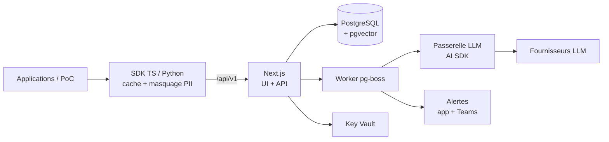

## Le problème

Les prompts des PoC IA du cabinet sont extraits du code par une skill dédiée mais n'ont ni historique, ni tests, ni garde-fou avant la prod. Un changement de prompt ou de modèle peut dégrader les réponses sans que personne ne le voie. Et les entrées réelles des utilisateurs dérivent dans le temps par rapport aux cas testés.

## La solution

Une plateforme qui centralise les prompts (import direct des exports produits par la skill d'extraction), les versionne de façon immuable et les promeut par étiquettes. Elle exécute des campagnes de tests sur n'importe quel fournisseur LLM via une passerelle unique, compare les résultats à la version en prod et bloque une promotion en `prod` en cas de régression (forçage possible par un admin, avec justification journalisée).

Des SDK TypeScript (`@promptops/sdk`) et Python (`promptops`) branchent les applications : récupération du prompt par étiquette avec cache et ETag, rendu côté application, collecte des appels réels après masquage des données personnelles.

## Architecture

## Fonctionnalités clés

- Workspaces et rôles (`lecteur`, `éditeur`, `admin`), projets, prompts créés à la main ou importés.
- Jeux de tests versionnés (saisie, import CSV/JSON), revue humaine et promotion d'une sortie en référence.
- Estimation du coût avant campagne et plafond de budget ; plafonds mensuels par workspace et pour l'instance.
- Comparaison côte à côte des modèles d'une même version : score, écart, coût, latence, cas divergents.
- Surveillances programmées qui rejouent une version figée pour mesurer la dérive dans le temps.
- Vue « Entrées réelles » : écart avec le jeu de tests par embeddings, évaluation d'un échantillon quotidien, conversion d'une collecte en cas de test.
- Vue d'ensemble : version en prod, dernier score, dérives ouvertes, volume collecté sur 7 jours, tendance sur 30 jours.
- Portabilité : export d'un projet au format natif et import dans une autre instance avec tout l'historique, sans secrets ni collectes.
- Sécurité : clés fournisseurs en Key Vault, garde anti-SSRF, jetons SDK hashés (SHA-256), rate limiting, contenu LLM non tracé par défaut.
- Qualité : vecteurs de conformité partagés entre le cœur et les deux SDK, cliquet de couverture, e2e Playwright des scénarios I1 à I6, releases versionnées avec artefact unique.

## Mon rôle

J'ai porté ce projet seul, de bout en bout : cadrage du besoin, conception de l'architecture, développement, tests, déploiement et démonstration.

## Résultats

- Version 1.0.0 livrée le 2026-10-21, incréments I0 à I6 terminés.
- CI complète : format, lint, typecheck, tests avec couverture sur Postgres de service, build, e2e, SDK Python (3.10 et 3.13), `terraform validate`, Trivy.
- Le déploiement d'une seconde instance « standalone » dans un abonnement vierge est reporté.

<!-- TODO: l'instance interne (mode reuse) est-elle déployée et utilisée ? Nombre de prompts / projets réellement importés ? -->
