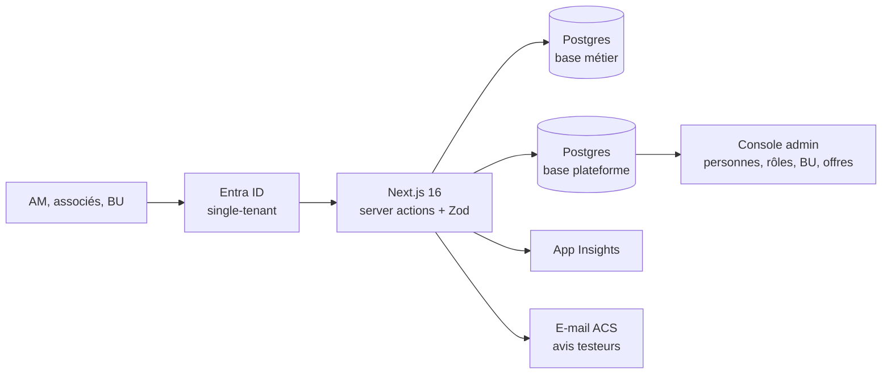

## Le problème

Saegus organise des revues de compte : des comités où les BU partagent ce qu'elles font sur chaque grand compte, s'engagent sur des actions et vérifient à la séance suivante qu'elles ont été tenues. Le but est de décloisonner les comptes.

Le support était un fichier HTML autonome de 2 Mo. Son bouton « Save » téléchargeait une copie figée : chaque revue produisait un fichier isolé, sans historique ni partage, qui circulait par mail. Les valeurs dérivées (taux d'atteinte, total du pipe) étaient saisies à la main.

## La solution

Une application web qui reproduit fidèlement le formulaire en 5 blocs de la maquette, mais change le socle :

- liste de comptes avec tiers et cadence, revues datées et consultables ;
- nouvelle revue pré-remplie avec les KPI, blancs et opportunités en cours ;
- suivi des engagements nominatifs et alerte des retards sur l'accueil ;
- valeurs calculées, donc jamais contradictoires ;
- statut des opportunités : une opportunité validée passe dans « Ce que nous avons gagné », chaque changement est journalisé.

Le chiffre, le staffing et la facturation restent dans l'ERP de gestion, qui fait foi : l'application ne garde que les chiffres déclaratifs utiles à la discussion.

## Architecture

Hébergé sur Azure App Service (plan partagé B1), base PostgreSQL mutualisée, secrets dans Key Vault.

## Fonctionnalités clés

- Formulaire de revue complet avec autosave différé (900 ms) et indicateur d'état.
- « Terminer mon passage » fige une version au nom de la personne ; « Modifier » rouvre pour le passage suivant (AM puis associés et BU).
- Détection de conflits par version et fusion à trois versions au rechargement.
- Tableau des actions, cockpit des retards, tableau de bord de pilotage (bêta) avec courbes par compte et vue par offre.
- Import des revues existantes depuis la maquette HTML, rejouable.
- Console d'administration commune : rôles Lecteur / Contributeur / Administrateur, inscription sans rôle des inconnus, rien ne se supprime.
- Sécurité : CSP à nonce par requête, HSTS, refus par défaut si le tenant n'est pas configuré, journal d'audit immuable.
- Instance de test pour les managers, avec recueil des avis par e-mail et dépôt dans l'outil ITSM interne.
- Script de déploiement local (build standalone, assemblage, envoi, vérification de la sonde de santé).

## Mon rôle

Seul développeur du repo : cadrage avec le manager, conception, développement, audits sécurité et UI/UX, déploiement et mise en production.

## Résultats

- Application en production, réservée au tenant de l'entreprise.
- Première liste d'accès de 9 personnes ouverte le 14/10/2026 (direction en Administrateur, directeurs et managers en Contributeur).
- Recette avec retours intégrés le 20/10/2026.
- <!-- TODO: nombre de comptes suivis et de revues tenues dans l'outil, retours des utilisateurs. -->
