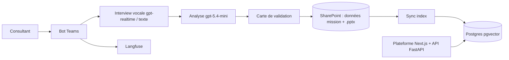

## Le problème

Les consultants accumulent à chaque mission un savoir précieux, mais il reste oral ou dispersé et se perd. Sans réflexe simple de capitalisation, l'entreprise ne sait pas finement « qui a fait quoi », et les nouveaux ne peuvent pas réutiliser ce qui a déjà été éprouvé.

## La solution

Un agent conversationnel dans Microsoft Teams qui interviewe le consultant à la fin de sa mission, à la voix ou à l'écrit, puis range la capitalisation dans SharePoint au bon endroit, à la bonne nomenclature et au format officiel. Il classe aussi les livrables envoyés en pièce jointe, répond aux questions sur les retours d'expérience déjà capitalisés et relance les consultants dont la mission est finie sans REX. Une plateforme web sert la recherche et le pilotage.

## Architecture

## Fonctionnalités clés

- Interview conversationnelle vocale (WebRTC direct, VAD, reprise) ou texte, qui demande client et mission avant de commencer.
- Pré-brief à partir des livrables existants : l'interview valide plutôt qu'elle n'interroge à froid.
- SharePoint source de vérité ; l'index vectoriel est un dérivé reconstructible (synchronisation idempotente et incrémentale).
- Aucune écriture sans validation : plan affiché en Adaptive Card, diff des champs, écriture après clic.
- Slides de référence et fiche REX en `.pptx` conformes au template officiel.
- Dépôt de livrables : lot de 1 à 10 fichiers, classement par phase, renommage normalisé, LLM seulement pour les noms ambigus.
- Mode consultation RAG avec sources cliquables, sans couper une interview en cours.
- Relance automatique des missions livrées sans REX.
- Sécurité issue d'un audit : SSO Entra, jeton de session opaque, rate limiting, pseudonymisation HMAC, téléchargement protégé contre le SSRF, contenu non envoyé à l'outil d'observabilité par défaut.
- Évaluation de l'interview par un consultant synthétique joué par un LLM, plus LLM-as-a-Judge.
- Huit ADR documentant les choix d'architecture.

## Mon rôle

Porteur et développeur unique du POC : cadrage, architecture, développement bot, back, front, infra et sécurité, passation.

## Résultats

- Écriture SharePoint validée en conditions réelles.
- 611 tests unitaires, 95,5 % de couverture.
- Passage derrière SSO Entra et remédiation de l'audit de sécurité.
<!-- TODO: pas encore d'usage par un groupe de consultants. -->
