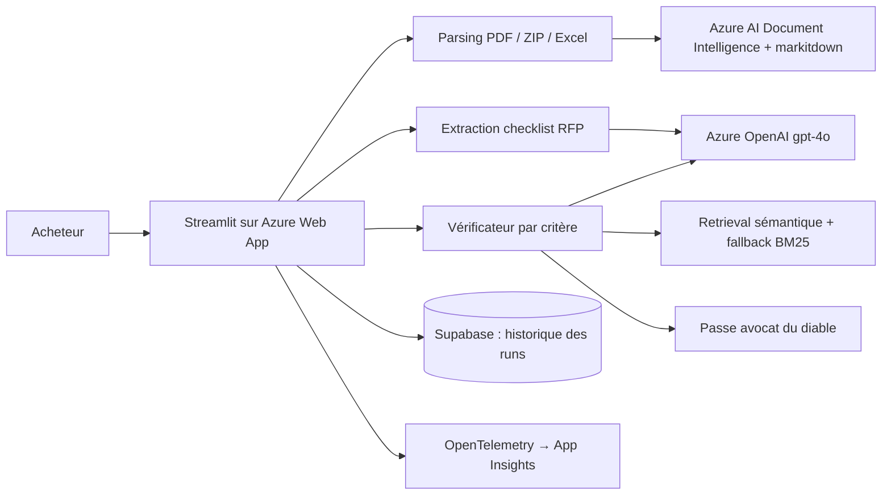

## Le problème

Le service achats d'un groupe de luxe international émet des appels d'offres et reçoit plusieurs réponses PDF à comparer à la main avec la grille d'exigences. C'est long (20 à 100 pages par dossier), risqué (un critère oublié laisse passer une offre non conforme) et non standardisé (chaque acheteur applique sa propre grille).

## La solution

Un agent IA qui ingère l'appel d'offres, en extrait toutes les exigences vérifiables, puis contrôle chaque réponse fournisseur critère par critère : conforme, partiel, non conforme ou non mentionné, avec une citation et la page source. Il extrait aussi le prix de chaque offre et produit un tableau récapitulatif comparatif, exportable.

## Architecture

## Fonctionnalités clés

- Extraction exhaustive de la checklist de l'appel d'offres : résumé, calendrier, parties prenantes, exigences catégorisées.
- Vérification de chaque exigence sur les pages les plus pertinentes de la réponse (embeddings, repli lexical BM25 si l'API échoue).
- Décomposition de chaque critère en sous-assertions, puis relecture « avocat du diable » des points non couverts pour éviter les faux partiels.
- Extraction du nom du fournisseur et du prix (montant, devise, périmètre).
- Entrées PDF, ZIP et Excel.
- Espace projets façon ChatGPT : historique des analyses persisté, renommage, suppression.
- CI GitLab : lint, tests avec couverture ≥ 80 % bloquante, LLM-as-a-Judge, scan Trivy, Terraform, déploiement via OIDC sans secret statique.

## Mon rôle

J'ai porté ce projet seul, de bout en bout : cadrage du besoin, conception de l'architecture, développement, tests, déploiement et démonstration.

## Résultats

<!-- TODO: aucun résultat mesuré dans le repo ; les objectifs du cadrage (couverture ≥ 95 %, précision ≥ 85 %, < 3 min) sont des cibles. Ne pas présenter la démo comme une mesure. -->

Le POC a ensuite été réutilisé comme brique de vérification d'appel d'offres dans un agent orchestrateur Achats (voir fiche procurement-agent).
