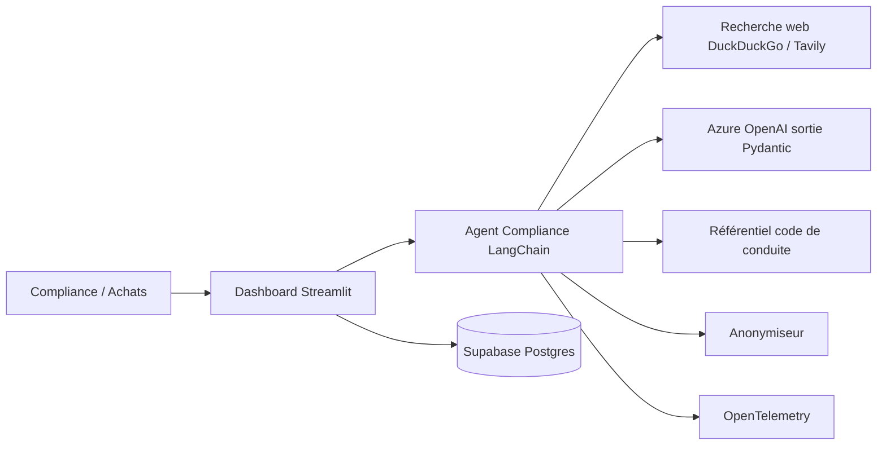

## Le problème

Un groupe de luxe international doit auditer en continu sa chaîne d'approvisionnement et ses partenaires pour repérer tôt tout risque financier, légal ou environnemental susceptible d'atteindre la réputation de ses marques. Ce travail de veille est manuel, dispersé entre sources et difficile à tracer.

## La solution

Un agent de compliance screening : à partir d'une liste de fournisseurs (nom, pays, domaine), il lance des recherches web ciblées par catégorie de risque, synthétise les faits avec un LLM en sortie structurée, et restitue un tableau de bord exécutif rouge / orange / vert où chaque verdict renvoie à ses sources.

## Architecture

## Fonctionnalités clés

- Audit par fournisseur en trois axes, avec requêtes spécialisées et sources épinglées pour l'axe légal et éthique.
- Évaluation alignée sur les exigences du code de conduite fournisseurs du client.
- Sortie JSON Pydantic stricte : synthèse factuelle, score par catégorie, liste des URLs justificatives.
- Due-diligence anonymisée des partenaires (remplacement du nom et des raisons sociales dans les textes).
- Découverte de fournisseurs par marque avec animation de recherche.
- Rapport : risque global, KPIs internes / externes, sidebar avec pastilles de score et recherche temps réel.
- Feedback 👍 / 👎 et métriques (durées, tokens) via OpenTelemetry.
- Quality gates GitLab : lint, tests ≥ 80 %, LLM-as-a-Judge, Trivy, Terraform.

## Mon rôle

Développeur unique du POC (conception, développement, CI).

## Résultats

<!-- TODO: aucun résultat mesuré dans le repo ; les critères du cadrage sont des cibles. Suite donnée à préciser. -->

Le POC a ensuite servi d'outil d'audit fournisseur dans un agent orchestrateur Achats (voir fiche procurement-agent).
