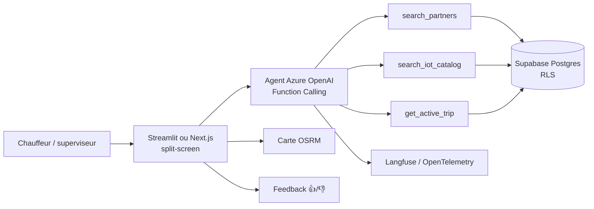

## Le problème

Le client, un groupe logistique, opère du transport routier longue distance dans plusieurs pays d'Afrique de l'Ouest. Aujourd'hui, le chauffeur appelle quand un problème survient : rupture de froid, vol, panne. La réaction est tardive et le contact utile n'est pas toujours connu.

Le client veut montrer en rendez-vous commercial une logistique connectée et proactive, où la flotte IoT détecte et l'IA oriente.

## La solution

Un démonstrateur en une seule interface :

- **Tour de contrôle** : trajet sélectionné, chauffeur, marchandise, capteurs actifs et attendus, progression sur la route, carte d'alerte typée (Froid / Sécurité / Flotte).
- **Assistant chauffeur** : le chat s'ouvre avec le contexte de l'alerte. Il comprend la demande, propose un partenaire certifié proche de la position actuelle et recommande un produit du catalogue IoT pour éviter la récidive.

Les données sont simulées. Un bandeau « Démo — données simulées » reste visible en permanence.

## Architecture

Pattern « Agent orchestrateur » : un LLM avec Function Calling interroge la base via trois tools. Le même schéma de données sert deux implémentations : Streamlit pour la démo terrain, Next.js pour une version cloud-ready.

Évolution prévue documentée en ADR : bascule vers une architecture événementielle (capteurs réels → webhook → même agent) sans changer les tools.

## Fonctionnalités clés

- Sélecteur de trajet et trois scénarios d'incident prêts à jouer.
- Message d'accueil du chat pré-rempli selon l'alerte du trajet.
- Filtrage des partenaires par service et zone géographique, du catalogue IoT par catégorie d'alerte.
- Carte interactive des routes réelles (OSRM) avec calcul de progression du trajet.
- Saisie vocale pour un usage terrain sans clavier.
- Mode dégradé sur données mock si la base n'est pas disponible (démo hors ligne).
- Feedback utilisateur sur chaque réponse, stocké en base et poussé dans les traces.
- CI GitLab : lint, tests > 80 % (Vitest et pytest), LLM-as-a-Judge ≥ 4/5, audit de dépendances et Trivy.

## Mon rôle

Seul contributeur au code, en tant que vibecodeur du projet : conception de l'architecture, double implémentation TypeScript/Python, CI et observabilité. Projet piloté avec un PMO et un manager.

## Résultats

- Démonstrateur livré et présenté au client. Satisfaction client notée 10/10 dans la fiche projet.
- Le message d'accueil contextuel et le layout split-screen ont été les éléments les mieux reçus en démo (RETEX).
- Modules identifiés comme réutilisables : carte OSRM, saisie vocale, tools Function Calling.
- Suite donnée : en attente. <!-- TODO: suite commerciale éventuelle -->
