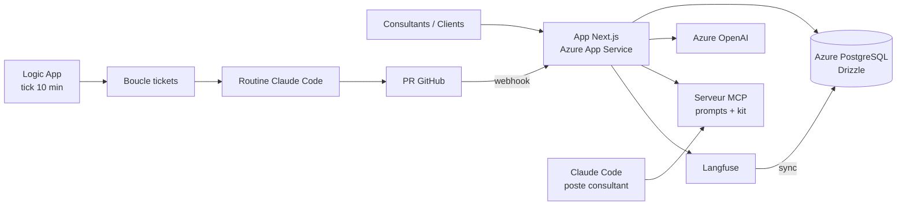

## Le problème

L'unité Vibe Office d'un cabinet de conseil produit des PoC IA à la chaîne, pour les clients et en interne. Sans outil commun, les idées arrivent par des canaux dispersés, les livrables ne sont pas visibles, et chaque PoC réinvente son outillage.

Deux irritants concrets ont aussi émergé :
- les prompts vivaient en dur dans le code des PoC : livrer le code source à un client revenait à lui céder la propriété intellectuelle du cabinet ;
- les tickets (bugs, avis, améliorations) s'accumulaient sans boucle de traitement rapide.

## La solution

Une plateforme Next.js hébergée sur Azure qui couvre tout le cycle de l'unité :

- **Boîte à idées** : les consultants soumettent des idées d'outils, qualifiées par un formulaire assisté par LLM (Azure OpenAI, résidence des données UE).
- **Showroom** : vitrine des réalisations, en version interne ou client, avec règles de visibilité (validation manager, validation obligatoire d'un associé pour toute donnée client anonymisée).
- **Tableau de bord de production** : KPIs pour les managers.
- **Serveur MCP** embarqué dans l'app : sert les prompts composés côté serveur (le template brut ne sort jamais), le prompt maître de la méthode, et le kit Claude Code.
- **Kit Claude Code** : skills `framing → spec → design → feature → check → fix → doc → push`, plus livrables (slides, vidéo, archive) et outils PoC (extraction de prompts, audit d'instrumentation, monitoring).
- **Boucle tickets → Claude Code** : les tickets sont synthétisés chaque jour ouvré (et en « synthèse éclair » pour les critiques), le décideur accepte ou refuse par lien signé sans login, puis une routine Claude Code on the web ouvre une PR par groupe. Le ticket passe à « Résolu » au merge, avec un mail au déclarant.

## Architecture

## Fonctionnalités clés

- RBAC à 5 rôles (client, consultant, manager, associé, développeur IA) et journal d'audit append-only alimenté par trigger PostgreSQL.
- Authentification Auth.js v5 par lien magique (Azure Communication Services).
- Serveur MCP : composition des prompts côté serveur, jetons révocables, télémétrie Langfuse en OTLP.
- Publication du kit : configuration Claude Code → manifeste versionné, puis deux sorties vérifiées par les mêmes empreintes SHA-256 (MCP de prod et dépôt miroir).
- Dépôt des fiches Showroom par une skill Claude Code de fin de projet, via le MCP.
- Kanban des tickets affichant l'état de chacun dans la boucle (en décision, en cours de code, PR ouverte, à reprendre) avec le lien de PR.
- Observabilité à 4 niveaux : infra et applicatif (Application Insights), IA (Langfuse : tokens, coût, latence, qualité), métier (complétion des formulaires).
- CI/CD : lint, scan Trivy (HIGH/CRITICAL bloquants), `terraform validate`, build standalone, déploiement ZipDeploy, sync d'observabilité planifiée.
- Documentation de conformité : RGPD / AI Act, registre des traitements, plan de tests sécurité, protection DDoS.

## Mon rôle

J'ai porté ce projet seul, de bout en bout : cadrage du besoin, conception de l'architecture, développement, tests, déploiement et démonstration.

## Résultats

- Plateforme déployée sur Azure App Service avec CI/CD complète.
- Spike de la boucle tickets → Claude Code validé 5/5 (push, PR, rappel, reprise).
- Kit Claude Code versionné et distribué : 19 skills, 3 commandes, 5 subagents.
- Purges successives des CVE HIGH/CRITICAL remontées par Trivy.

<!-- TODO: chiffres d'adoption (idées soumises, livrables publiés, utilisateurs, PR ouvertes par la boucle) — rien de mesuré dans le repo. -->
